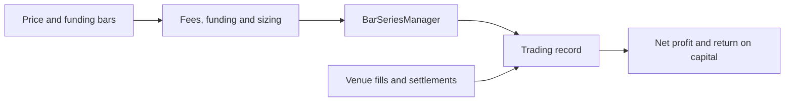

# Perpetual Futures

Use this page when you want to model or record perpetual futures with ta4j's existing trading APIs.

Requires ta4j 0.28.1 or later. The supporting core changes are pending human merge; see the [funding](https://github.com/ta4j/ta4j/pull/1727), [sizing](https://github.com/ta4j/ta4j/pull/1731), [return on capital](https://github.com/ta4j/ta4j/pull/1732), [examples](https://github.com/ta4j/ta4j/pull/1733), and [recorded holding costs](https://github.com/ta4j/ta4j/pull/1734) PRs before using these APIs.

## 1) A perpetual in one minute

A perpetual future is a derivative with no expiry. Like spot, its linear price change times base-asset amount determines gross profit; unlike unlevered spot, a trader can use leverage and pays or receives periodic funding. Leverage increases exposure and loss as well as potential profit. Funding is a signed holding cost, not an entry fee.

| Your goal | Start here |
| --- | --- |
| Run a small offline example | [Quickstart](Perpetual-Futures-Quickstart.md) |
| Model real historical data and risk | [Backtesting](Perpetual-Futures-Backtesting.md) |
| Record venue fills and settlements | [Live trading](Perpetual-Futures-Live-Trading.md) |
| Adapt a particular technique | [Cookbook](Perpetual-Futures-Cookbook.md) |

## 2) Concepts and APIs

| Concept | ta4j API |
| --- | --- |
| Linear notional | Price times amount in base units |
| Fees | `LinearTransactionCostModel`; actual fill fees use `RecordedTradeCostModel` |
| Funding | `FundingCostModel` as a holding cost; recorded settlements via `TradingRecord.recordHoldingCost` |
| Leverage and lot step | `PositionSizer.balance(...).leveraged(...).roundedDownTo(...)` |
| Return on committed capital | `ReturnOnCapitalCriterion` |
| Approximate liquidation threshold | `StopLossRule` combined with the strategy exit |

## 3) Boundaries

ta4j does not provide a contract metadata type, margin account, cross-margin engine, exchange liquidation fills, or native inverse/quanto valuation here. Convert contract sizes in your adapter, supply venue data yourself, and use a stop only as an approximation. An inverse contract can be represented using reciprocal prices; see [Backtesting](Perpetual-Futures-Backtesting.md#8-inverse-contracts).

## 4) Glossary

- **Notional:** price times base amount for a linear contract; exposure, not deposited margin.
- **Contract size:** base units per linear contract, or quote face value per inverse contract.
- **Initial margin:** capital committed to establish exposure. **Maintenance margin:** minimum required to keep it open.
- **Leverage:** exposure divided by committed capital; it magnifies gains and losses.
- **Funding rate and interval:** signed periodic transfer rate and settlement cadence between long and short positions.
- **Mark price versus last price:** a venue's reference price for settlement/risk versus the latest trade; they can differ.
- **Linear versus inverse:** linear profit is in quote currency; inverse profit is in base coin and uses reciprocal prices.
- **Liquidation:** venue-enforced position closure when margin is insufficient; it is not simulated by the stop recipe.

## Related pages

- [Quickstart](Perpetual-Futures-Quickstart.md)
- [Backtesting](Perpetual-Futures-Backtesting.md)
- [Live trading](Perpetual-Futures-Live-Trading.md)
- [Cookbook](Perpetual-Futures-Cookbook.md)
